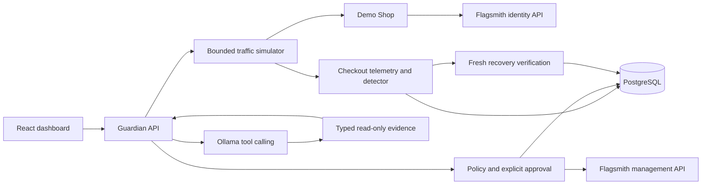
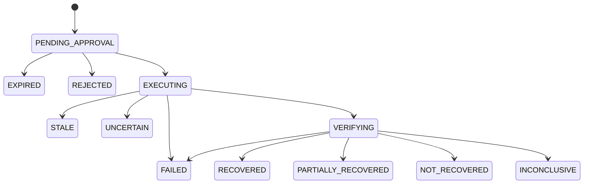

# Architecture

Guardian and Shop run as separate Spring Boot processes from one Java 17-compatible artifact. Shop receives real checkout HTTP requests and evaluates the synthetic identity through Flagsmith. The Guardian simulator times the HTTP outcome and retains at most 10,000 recent samples in memory. Detection uses bounded comparison windows, nearest-rank P95, sample thresholds, severity, and deduplication. Completed incident windows are persisted.

The agent is a bounded Ollama conversation with typed read-only tools bound to the incident. It selects evidence tools from the observed symptoms, then returns a JSON-schema-constrained finding. Deterministic rules constrain the recommendation when measured evidence supports a shared failure or a rollback proposal. The service validates the trace, required evidence and structured result. The model sees aggregate samples and allowlisted configuration fields. It receives no request headers, API keys, shell, credentials, or write operation. Read-only history is labeled as ReleaseGuard observations.

The proposal stores the exact loaded flag configuration and its revision, incident, environment, requester, expiration, desired state and decision. A PostgreSQL row lock serializes claims for execution. Immediately before the network write, the executor reloads the current configuration and verifies policy, target and expiration. It explicitly sets the legacy environment default to disabled. Verified management readback starts a new recovery window. A final state read and fresh cohort telemetry produce the recovery classification.

Flyway manages the Guardian schema. Incident, investigation, and proposal tables store typed JSON snapshots with foreign keys and uniqueness constraints. A separate event table records workflow transitions through insert-only application operations. Flagsmith has its own database. Compose publishes browser ports on loopback. The dashboard reverse proxies the API on the same origin.

The API supports a dedicated legacy Flagsmith environment with a single payment flag mutation path. An external client can still modify Flagsmith between the management read and PATCH because legacy Flagsmith exposes no atomic conditional write for this path. Recovery treats an inconclusive write as an operator reconciliation case. Run one Guardian replica for the in-memory monitor and simulator.
